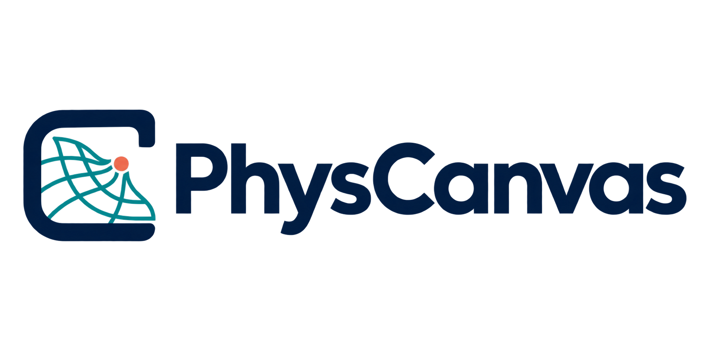

<p align="center">
  
</p>

# PhysCanvas

**A Vision-Tactile Simulator for RL Post-Training**

[Project page](https://zebinx.github.io/PhysCanvas_HomePage/) | [arXiv paper](https://arxiv.org/abs/2610.28613) | [Full overview video](https://zebinx.github.io/PhysCanvas_HomePage/assets/overview.mp4)

PhysCanvas is a vision-tactile simulator for robot policy evaluation and RL post-training. This release provides model inference, evaluation code, and full-episode input data. Training and post-training code will be released after review.

## News

- 🔥 **2026.11.01** | Initial evaluation code submitted.
- 🔥 **2026.10.20** | [arXiv version](https://arxiv.org/abs/2610.28613) released.

## Preview

A short generation preview from the [project video](https://zebinx.github.io/PhysCanvas_HomePage/assets/overview.mp4).

<video src="assets/physcanvas-preview.mp4" poster="assets/physcanvas-preview.jpg" width="720" controls muted playsinline></video>

[Watch the short MP4](assets/physcanvas-preview.mp4) | [View the preview frame](assets/physcanvas-preview.jpg)

## Contents

- 🔨 [Setup](#setup)
- 📊 [Evaluation](#evaluation)

## Todo list

- [ ] World Model training and FM/VLA/WAM post-training code and weights
- [x] [arXiv paper](https://arxiv.org/abs/2610.28613)
- [x] [Epoch-30 evaluation weights](https://www.modelscope.cn/models/ArteMe/PhysCanvas_model/files)
- [x] [Full-episode evaluation inputs](https://huggingface.co/XXXXing/PhysCanvas_model/tree/main/evaluation-data/full-episode) for 20 episodes

## Setup

Install in a Linux PPU/CUDA environment. The validated versions are PyTorch 2.7.0, Diffusers 0.38.0, Transformers 4.53.3, and `giga-datasets`/`giga-train` 1.0.0.

```bash
python -m pip install -e .
python -m unittest discover -s tests -v
```

`PhysCanvas/` contains the model and input transforms; `evaluation/` contains rollout and metric code.

The same release layout is available from [ModelScope](https://www.modelscope.cn/models/ArteMe/PhysCanvas_model/files) and [Hugging Face](https://huggingface.co/XXXXing/PhysCanvas_model/tree/main):

| Content | Repository path | Use |
| --- | --- | --- |
| Trained World Model transformer | `weights/epoch30_step300/transformer/` | Epoch-30 inference checkpoint, stored as verified parts. |
| Evaluation data | `evaluation-data/full-episode/` | 20 full episodes, with an archive index and checksums. |

Keep the large files outside the code checkout. From the project root, download the model and data into `$HOME/physcanvas-assets`, then link them into the project:

```bash
export PHYSCANVAS_STORE="$HOME/physcanvas-assets"
python -m tools.download_model --source modelscope --download-dir "$PHYSCANVAS_STORE"
python -m tools.download_eval_inputs --source modelscope \
  --download-dir "$PHYSCANVAS_STORE" \
  --prepared-dir "$PHYSCANVAS_STORE/cohort20_full_prepared"
ln -sT "$PHYSCANVAS_STORE" data
ln -sT "$PHYSCANVAS_STORE/weights" models
```

Use `--source huggingface` in both download commands to use the Hugging Face mirror. The scripts verify the published hashes; the data command also unpacks and prepares the 20 episodes. Reserve at least 50 GiB of free space for the archives, prepared inputs, model parts, and assembled checkpoint. The resulting project paths are `models/epoch30_step300/transformer/` and `data/evaluation-data/full-episode/`; neither large directory is committed to Git. Wan VAE/scheduler, prompt embedding, and optional metric-model assets are separate prerequisites.

## Evaluation inputs

| Argument | Input |
| --- | --- |
| `--checkpoint` | Checkpoint directory or its `transformer/` subdirectory. |
| `--config-json` | Evaluation configuration. |
| `--archives-dir` | Full-episode archives and `index.json`. |
| `--prepared-dir` | Scratch directory for prepared inputs. |
| `--prompt-embedding` | Prompt embedding used by the model. |
| `--output-dir` | Evaluation output directory. |
| `--threshold-json` | Frozen tactile-flow thresholds for metric evaluation. |
| `--i3d-weights` | I3D weights for FVD. |

The [20 selected episodes](evaluation/data/fixed_20_ids.json) have five examples per task. The Setup commands download, verify, and prepare them. Use `--dry-run` to check the prepared cohort before inference.

## Single-episode example

The first full-episode bottle-cap archive contains 249 aligned frames: RGB and tactile videos, sensor arrays, labels, and motion conditions for the entire episode.

```bash
tar -xzf data/evaluation-data/full-episode/bottle-cap/01_bottle-cap_full.tar.gz -C data
python tools/raw_fixture.py prepare \
  --fixture-dir data/fixture \
  --output-dir data/bottle_full_prepared
```

`prepare` verifies the archive and creates model-ready inputs using only the compressed package. The motion conditions are derived inputs, so this is not a raw-sensor-only release.

## Data Preparation

The data folders use task names only:

| Folder | Task | Archives |
| --- | --- | ---: |
| `evaluation-data/full-episode/bottle-cap/` | Bottle cap |
| `evaluation-data/full-episode/test-tube/` | Test tube |
| `evaluation-data/full-episode/building-blocks/` | Building blocks |
| `evaluation-data/full-episode/rubiks-cube/` | Rubik's cube |

If you downloaded the archives separately, prepare them with:

```bash
python -m tools.cohort_fixture prepare \
  --source-dir data/evaluation-data/full-episode \
  --output-dir data/cohort20_full_prepared
```

The prepared inputs need about **18.4 GiB** of additional disk space. All 20 archives were decoded independently and their complete motion timelines were checked against the source caches; this input check is not a new inference result.

## Evaluation

### Full-episode visualization

Generate one multimodal MP4 per episode without computing metrics:

```bash
physcanvas-infer-all-n \
  --archives-dir data/evaluation-data/full-episode \
  --prepared-dir data/cohort20_full_prepared \
  --horizons full \
  --checkpoint models/epoch30_step300 \
  --config-json evaluation/data/public_eval_config.json \
  --pretrained-vae /path/to/wan-diffusers \
  --prompt-embedding /path/to/default_prompt_embeds.pth \
  --output-dir data/visual_eval_examples \
  --device cuda:0 --resume
```

`full` uses each episode's complete length. Denoising uses 30 steps by default. Videos are written under `data/visual_eval_examples/infer-all-n/full/`.

### N=128 evaluation

Evaluate the first 128 frames of each eligible episode and verify the output videos:

```bash
physcanvas-evaluate-reconstruction \
  --archives-dir data/evaluation-data/full-episode \
  --prepared-dir data/cohort20_full_prepared \
  --checkpoint models/epoch30_step300 \
  --config-json evaluation/data/public_eval_config.json \
  --pretrained-vae /path/to/wan-diffusers \
  --prompt-embedding /path/to/default_prompt_embeds.pth \
  --threshold-json evaluation/data/flow_threshold.json \
  --i3d-weights /path/to/i3d_torchscript.pt \
  --output-dir data/visual_eval_examples \
  --device cuda:0 --resume
```

Results are written to `data/visual_eval_examples/metrics-128/n128/`. Run `--resume` only with the same inputs and model. Metric definitions and asset requirements are in the [evaluation protocol](evaluation/ADDITIONAL_METRICS.md).

Check `COMPLETED.json` and video frame counts before using the results. FID/FVD require the full cohort; one example is only a functionality check.

## Citation

If you find PhysCanvas useful in your research, please cite our [paper](https://arxiv.org/abs/2610.28613):

```bibtex
@misc{xing2026physicalcanvas,
  title = {Physical Canvas: A Vision Tactile World Model For Robot Policy Evaluation And Learning},
  author = {Zebin Xing and Yuhang Zheng and Yupeng Zheng and Yichen Zhang and Zichen Li and Shangqing Zhou and Yujie Zang and Yuchen Liu and Zhongpu Xia and Haoran Li and Qichao Zhang},
  year = {2026},
  eprint = {2610.28613},
  archivePrefix = {arXiv},
  primaryClass = {cs.RO},
  url = {https://arxiv.org/abs/2610.28613}
}
```

## Acknowledgements

We thank the teams behind [WoVR](https://arxiv.org/abs/2602.13977), [iMac](https://github.com/imac-wm/iMac), and [RLinf](https://github.com/RLinf/RLinf) for their inspiring open-source work on world-model-based policy post-training, embodied world models for policy evaluation, and reinforcement learning infrastructure, respectively. Their contributions provided valuable inspiration for PhysCanvas.

## Pi0.5 policies: closed-loop rollout and GRPO

The [policy guide](policy/README.md) adds two tasks: **building blocks** (`jimu`) and **both-arm test tube** (`shiguan`). Pi0.5 proposes 16 actions from the current observation. The existing PhysCanvas world model generates two successive 8-frame segments, and a three-view reward model scores the generated frames. If the episode continues, Pi0.5 replans from the latest generated observation. During GRPO, the policy's action expert and projections are updated; the visual and tactile encoders stay frozen.

| To run | Start here |
|---|---|
| Closed-loop rollout or GRPO | [Environment setup, required assets and launch commands](policy/README.md#environments) |
| Prepare data and fine-tune tactile Pi0.5 | [Static-frame trimming and LeRobot conversion](policy/docs/DATA_PROCESSING.md) · [Supervised training and checkpoint conversion](policy/docs/POLICY_TRAINING.md) |
| Train a three-view reward model | [Input format, labels and training commands](policy/docs/REWARD_TRAINING.md) |

The [ModelScope weight repository](https://modelscope.cn/models/ArteMe/PhysCanvas_model/files) provides three PyTorch policies under `policy/`: `pi05_base`, `pi05_building_blocks_wm_grpo` and `pi05_test_tube_wm_grpo`. Keep the weights outside the code checkout. Policy training data, reset datasets and trained reward-model weights are not distributed. See the [validation record](policy/VALIDATION.md) for the checks performed and their scope. For WM-only evaluation, the [original setup](#setup) and [evaluation instructions](#evaluation) above still apply.
